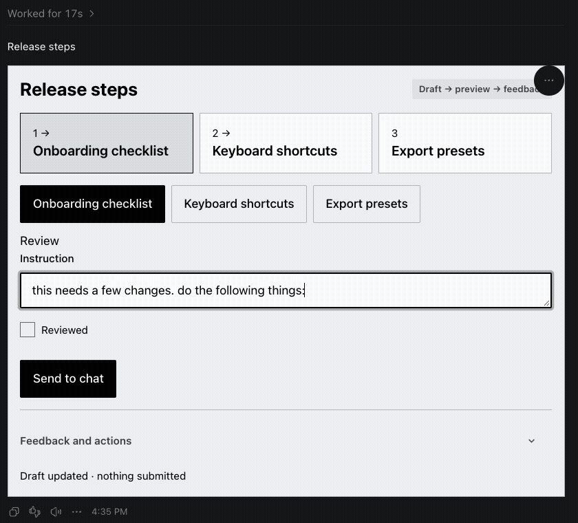
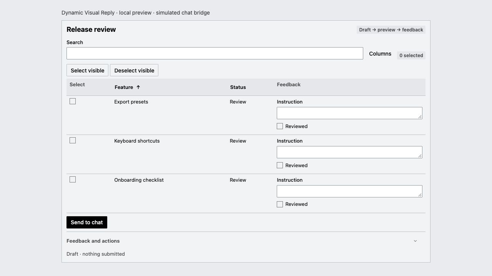
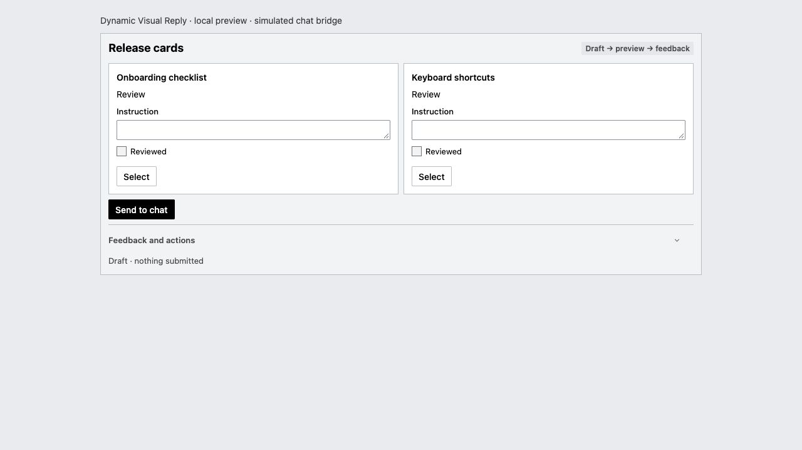
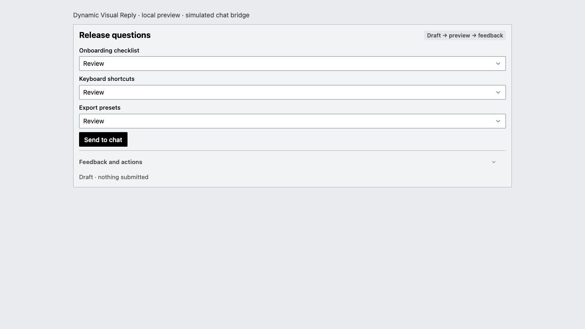
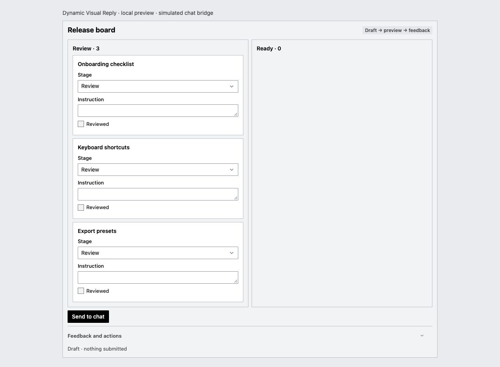
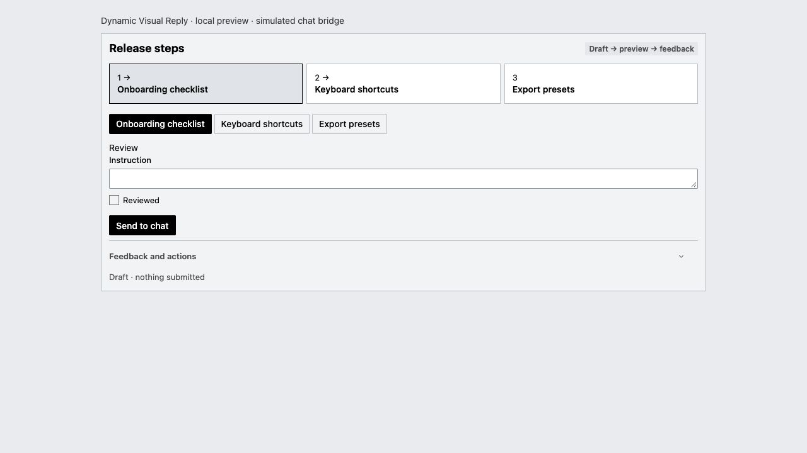
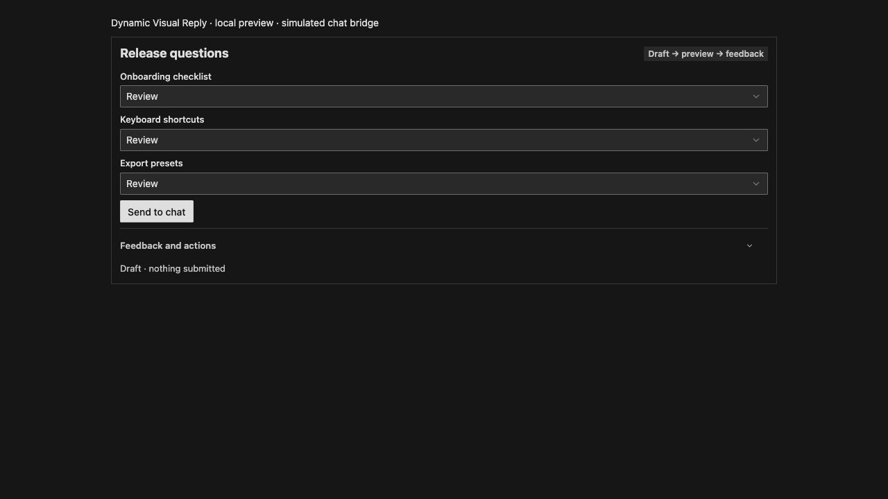

# Dynamic Visual Reply

**Review several items. Reply once.**

Dynamic Visual Reply is an agent skill that turns multi-item reviews into interactive tables, cards, forms, boards, and step views. Select items, edit values, and attach instructions to individual records, then send one batch of feedback to your agent.

One shared renderer, built with [Oat](https://github.com/knadh/oat) and [Preact](https://preactjs.com/), provides light and dark themes, neutral controls, 2 px corners, and brief CSS motion. The renderer is bundled with the skill—no CDN, API key, or separate service is needed.

## When to use it

Use a widget when several items need different responses. Keep short answers, prose, and overall feedback in chat.

| View | Useful for |
| --- | --- |
| Table | Compare records, select a batch, and edit individual values |
| Cards | Review alternatives and add an instruction to each |
| Form | Answer several questions in one submission |
| Board | Move items between stages and explain changes |
| Flow | Review a sequence and respond to individual steps |

Selections and edits stay drafts until you submit them. Submitting sends instructions to the agent; it does not directly change your tasks or source data.

## Token size benchmark

The agent writes a JSON spec; the Node helper supplies the existing UI. The table below estimates the tokens in each bundled example's spec, without optional JSON whitespace.

| Widget | Example size | Estimated spec tokens |
| --- | --- | ---: |
| [Table](skills/dynamic-visual-reply/assets/examples/table.json) | 4 records, 3 columns | 169 |
| [Cards](skills/dynamic-visual-reply/assets/examples/cards.json) | 3 cards | 131 |
| [Form](skills/dynamic-visual-reply/assets/examples/form.json) | 4 fields | 175 |
| [Board](skills/dynamic-visual-reply/assets/examples/kanban.json) | 3 items | 83 |
| [Flow](skills/dynamic-visual-reply/assets/examples/flow.json) | 4 steps | 97 |

Counted on October 30, 2026, with [js-tiktoken](https://github.com/dqbd/tiktoken/tree/main/js) 1.0.21 and the `o200k_base` encoding. These are **spec-text estimates, not measured total tokens per widget**. They exclude chat context, skill instructions, reasoning, tool calls, captions, and feedback replies. Model tokenizers, formatting, and content length can change the counts. No usability or percentage token-savings comparison was measured.

Running the Node renderer uses **zero model tokens**. Codex and local browser routes use generated files directly. Claude's inline route also passes the complete generated HTML through model context, so the spec counts alone do not describe that route's cost. No token-counting package is required to install or use the skill.

## Widget previews

### Inside Codex

Recorded in a real Codex chat: enter instructions for individual steps and use **Send to chat**. The clip shows the native widget and its button; the complete feedback receipt was verified separately in the same chat. It predates the compact spacing update; the component gallery below shows the current sizing.



The demo agent received instructions for `onboarding`, `shortcuts`, and `export` with their IDs intact. This verifies the Codex route; Claude's native route remains unverified.

### Component gallery

These screenshots show all five views using fictional release tasks. They use the shared renderer in a local preview with a labeled simulated chat bridge.

### Table

Select records and attach an instruction to each one.



### Cards

Compare alternatives and respond to each card.



### Form

Collect several answers before submitting one message.



### Board

Review items by stage and prepare changes as a draft.



### Flow

Review one step at a time and give feedback on individual steps.



Both themes use the same controls and layout:



## Requirements

- **An agent with file access and command execution** to read the skill and run its helpers.
- **Node.js 22.20+** on the machine where the agent runs. The helpers validate JSON specs, generate HTML, and run the local feedback server using Node built-ins. No Python or runtime npm packages are required.
- **A browser or supported inline rendering** to display the result. Codex can use its documented `visualize` content-reference contract without a separate widget tool. Claude inline requires a suitable host widget tool. All routes use the same prebuilt JavaScript renderer.

The renderer is prebuilt, so normal use needs no npm install or build step. The optional installer below also requires Git; manual installation uses the same Node runtime.

## Install

From the project where you want to use the skill:

```sh
npx skills add neha-nupoor/dynamic-visual-reply --skill dynamic-visual-reply
```

Choose your agent when prompted. To select one directly:

```sh
npx skills add neha-nupoor/dynamic-visual-reply --skill dynamic-visual-reply --agent codex --yes
```

Replace `codex` with `claude-code`, `cursor`, `windsurf`, `gemini-cli`, or `github-copilot`. Add `--global` for an installation shared across projects. Restart your agent session or reload skill discovery after installation. See the installer's [supported agents](https://github.com/vercel-labs/skills/blob/main/docs/agents.md) and [commands](https://github.com/vercel-labs/skills/blob/main/docs/commands.md) for other options.

### Manual installation

```sh
git clone https://github.com/neha-nupoor/dynamic-visual-reply.git
```

Copy the entire `skills/dynamic-visual-reply` directory from the clone into your agent's skill directory. Include its scripts, configuration, references, and assets; copying only `SKILL.md` is insufficient. If your agent has no skill loader, ask it to read that `SKILL.md` explicitly.

## Use it

Ask your agent:

> Use dynamic-visual-reply to show these five proposals as a review table. Let me select proposals and add an instruction to each, then submit one batch.

The agent chooses a view, writes a JSON spec, and runs the bundled helper. You review the widget and submit when ready. Stable record IDs keep your feedback attached to the right items across sorting, filtering, and compatible updates.

Your agent checks the current session's documented rendering contracts and available tools before choosing where to display a view:

| Environment | Display route |
| --- | --- |
| Codex with the documented `visualize` content-reference contract | Inline for small views; local browser for larger ones |
| Codex terminal without that contract | Local browser or browser panel |
| Claude chat with a suitable inline widget tool | Embedded HTML fragment; local browser if the payload is unsuitable |
| Claude Code, Cursor, Windsurf, Gemini CLI, GitHub Copilot | Local browser or browser panel |
| Browser without a feedback bridge | Offline HTML with copy/export |

Installing a skill does not add rendering APIs to a harness. Codex's documented content-reference contract does not require a dedicated widget tool. Claude Code installation and Claude chat widget availability are separate capabilities. A chat-only session without file access and command execution cannot run these helpers by installation alone.

If you explicitly request inline display and the Codex contract is available, the agent overrides automatic item-count and height rules. The inline payload limit still applies.

All routes embed the same renderer and CSS. Claude's inline tool takes the complete HTML as a string, including about 82 KB of renderer plus view data, so it uses more model context than a file-based handoff. Its native rendering and feedback path have not yet been verified; browser fixtures use simulated host bridges. Follow the current host tool's instructions and limits.

If rendering is unavailable or fails, the agent provides the intended answer as normal Markdown. The browser route remains an option when interaction is useful.

### How feedback reaches the agent

- **Codex inline:** **Send to chat** uses the native bridge when available. Inline display can work without the submission API; in that case, use Prepare message, Copy, or Export JSON to return feedback yourself.
- **Claude inline:** **Add to chat** prepares the message through the host bridge; press Enter to send it.
- **Local browser:** **Submit answers** or **Submit instructions** saves feedback locally. Return to chat and ask the agent to continue; the agent reads the saved feedback. Submission does not start an agent turn by itself.
- **Offline file:** copy the prepared feedback or export JSON, then return it to the agent in chat.

Drafts, preview, copy/export, and undo support deliberate submission. The agent should acknowledge the feedback it actually receives.

## Try a sample locally

Set `reply_skill_dir` to your installed skill directory—the folder containing `SKILL.md`. For example, a project-local Codex installation commonly uses `.agents/skills/dynamic-visual-reply`. Find the actual path with `npx skills list --agent codex`, or use the directory you copied manually.

```sh
reply_skill_dir="$PWD/.agents/skills/dynamic-visual-reply"
reply_preview_dir="$PWD/dynamic-visual-reply-preview"
mkdir -p "$reply_preview_dir"

node "$reply_skill_dir/scripts/doctor.mjs" --harness browser-local
node "$reply_skill_dir/scripts/render.mjs" \
  --spec "$reply_skill_dir/assets/examples/form.json" \
  --out "$reply_preview_dir/form.html" \
  --harness browser-local
node "$reply_skill_dir/scripts/serve.mjs" "$reply_preview_dir/form.html" --port 0
```

Open the local URL printed by the server. Keep it running while reviewing, submit your answers, then ask the agent to read the printed feedback file. Stop the server when finished. On Windows, use the equivalent paths and variables for your shell.

`doctor.mjs` checks local files, configuration, bundle hashes, and theme contrast. It cannot establish that an inline host tool or submission bridge exists.

## Appearance

Desktop views use compact spacing: 14 px body text, 32 px controls, and an 18 px inline title. Touch controls retain larger targets. Codex and Claude share this preset; native host density is not detected automatically. Existing theme settings can override the sizes.

Appearance follows the host where supported, with OS preference as a fallback. Explicit choices take priority:

`spec → command-line flag → project settings → user settings → harness default`

To choose a fixed appearance, add this to your project's `.dynamic-visual-reply.json` or your user settings at `~/.config/dynamic-visual-reply/config.json`:

```json
{"appearance":"dark"}
```

Use `"light"` for light mode, or `null` to restore the harness default. Preserve any other settings already in the file. A single generic theme supplies both palettes; custom theme packs and wording overrides are supported. See the [theme guide](skills/dynamic-visual-reply/references/theme.md) and [renderer contract](skills/dynamic-visual-reply/references/renderer-contract.md).

## Troubleshooting

- **Skill is not discovered:** check its installation path and restart the agent session. Verify the complete skill folder was installed.
- **Node is missing:** install Node.js 22.20+ where the agent executes commands. The prebuilt renderer needs no npm install.
- **Widget does not appear:** check the host's documented rendering contract, required tools, and payload limits. Codex does not need a separate widget tool when its content-reference contract is available. Use the browser route when available, or continue in normal chat.
- **Browser feedback does not arrive:** use the server's HTTP URL rather than opening the file directly. Submit, then ask the agent to read the feedback file; local submission does not wake the agent.
- **Settings fail after updating:** older installations may contain an obsolete `delivery` object or use the former `visual-response-design` skill name. See [migration guidance](skills/dynamic-visual-reply/references/renderer-contract.md#migrating-older-installations). Disable the old skill after checking the new installation to avoid duplicate discovery.

## For contributors

The skill entrypoint is [SKILL.md](skills/dynamic-visual-reply/SKILL.md). Supporting files follow the standard skill layout:

```text
skills/dynamic-visual-reply/
├── SKILL.md
├── agents/openai.yaml       # Optional OpenAI display metadata
├── scripts/                 # Render, serve, checks, and host adapters
├── config/                  # Defaults, one generic theme, and schemas
├── references/              # Detailed contracts and host guides
└── assets/                  # JSON examples and the shared renderer
```

Normal users do not need to build the renderer. For implementation changes, follow the [renderer contract](skills/dynamic-visual-reply/references/renderer-contract.md#maintenance) and [UI behavior guide](skills/dynamic-visual-reply/references/ui-behavior.md).

Git commits identify skill revisions; bundle hashes identify renderer bytes. Dependency pins and compatibility markers are retained. There is no routine skill version bump or tag-publishing workflow.

## License

MIT. Bundled Oat and Preact notices are included with the renderer.
