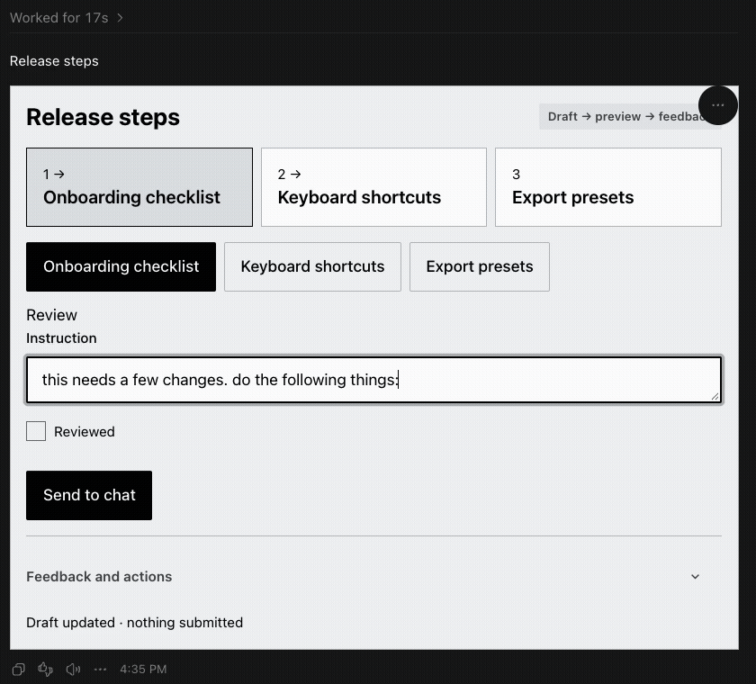
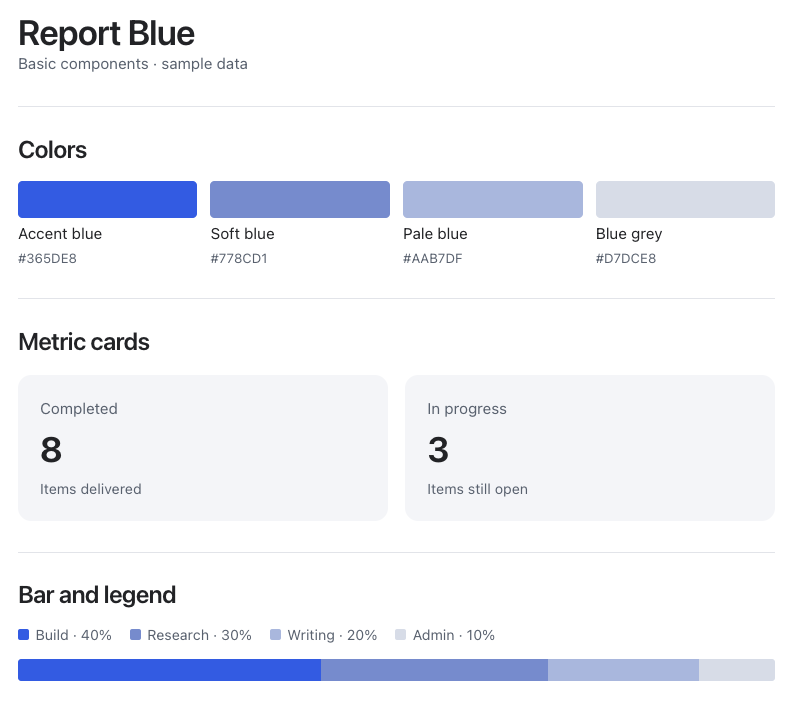
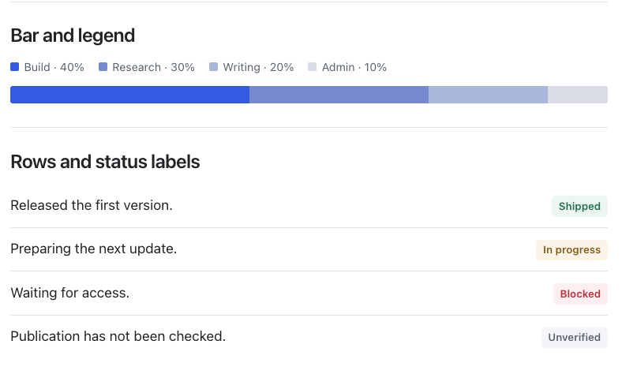
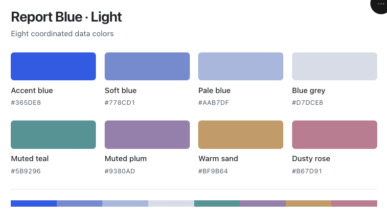
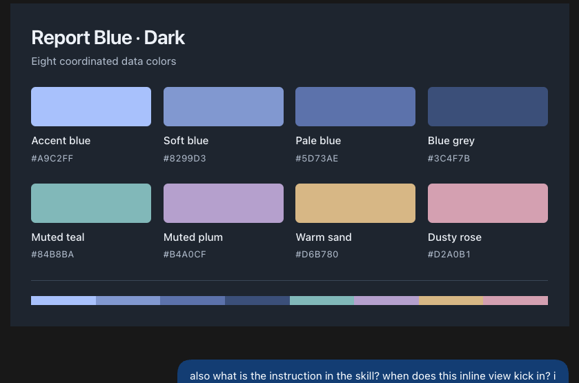
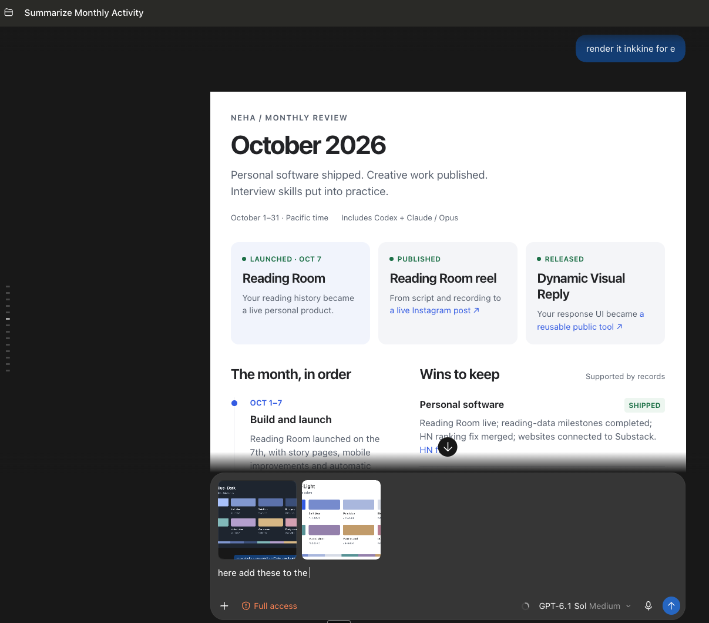

# Details

Prefer the blue-accent report style? The optional [Report Blue kit](../skills/dynamic-visual-reply/references/report-kit.md)
includes eight coordinated data colors in light/dark themes and CSS-only metric cards, status labels, rows, legends
and simple bars. It works with the existing theme loader and adds **zero JavaScript
to the renderer bundle**. It includes no personal report data or monthly layout.

## Token size benchmark

The agent writes a JSON spec; the Node helper supplies the existing UI. The table below estimates the tokens in each bundled example's spec, without optional JSON whitespace.

| View | Example size | Review spec tokens | Read-only spec tokens |
| --- | --- | ---: | ---: |
| [Table](../skills/dynamic-visual-reply/assets/examples/table.json) | 4 records, 3 columns | 169 | 174 |
| [Cards](../skills/dynamic-visual-reply/assets/examples/cards.json) | 3 cards | 139 | 144 |
| [Form](../skills/dynamic-visual-reply/assets/examples/form.json) | 4 fields | 175 | 180 |
| [Board](../skills/dynamic-visual-reply/assets/examples/kanban.json) | 3 items | 83 | 88 |
| [Flow](../skills/dynamic-visual-reply/assets/examples/flow.json) | 4 steps | 111 | 116 |

Recounted November 3, 2026 with Python `tiktoken` 0.9.0 and `o200k_base`.
For each bundled example, serialize parsed JSON with `json.dumps(spec,
separators=(",", ":"), ensure_ascii=False)` and count encoded tokens. The read-only
column uses the identical spec with `"readOnly": true` added: **5 extra spec tokens**.
This is a matched content comparison; removing unused review fields may reduce a
real report's spec. The separate [read-only cards example](../skills/dynamic-visual-reply/assets/examples/read-only-cards.json)
contains two records and uses **89 spec tokens**.

These are **spec-text counts, not measured total model consumption**. They exclude
chat context, loaded skill instructions, reasoning, tool calls, captions and
feedback. Different tokenizers and content change the counts. No total-token
savings or usability comparison was measured. Read-only mode removes feedback
controls and draft calls; it still embeds the same renderer bundle.

Running the Node renderer uses **zero model tokens**. Codex and local browser routes use generated files directly. Claude's inline route also passes the complete generated HTML through model context, so the spec counts alone do not describe that route's cost. No token-counting package is required to install or use the skill.

## Size of read-only and Report Blue additions

Compared with commit `502c904`, before these additions:

| Shipped asset | Before | After | Increase |
| --- | ---: | ---: | ---: |
| Shared renderer JavaScript, uncompressed | 82,426 bytes | 83,756 bytes | 1,330 bytes (1.61%) |
| Optional Report Blue component CSS | 0 | 3,432 bytes | 3,432 bytes |
| Optional Report Blue theme JSON | 0 | 2,542 bytes | 2,542 bytes |

Read-only behavior accounts for the JavaScript increase. Palette and CSS primitives
add zero renderer JavaScript. Optional theme/CSS assets total 5,974 bytes on disk;
generated HTML includes the exported token CSS rather than the theme JSON file.
The 2,449-byte sample HTML and README screenshots are documentation assets, outside
the renderer bundle. These byte counts do not measure model tokens or compressed
transfer size. The read-only token comparison above measures authored specs only.

## Widget previews

### Interactive HTML demo

[Open the response-design explorer](demos/response-design-explorer.html).
Download the HTML file and open it in a browser. It is one self-contained file
with inline CSS and JavaScript: no install, server, API key or external assets.
GitHub shows the source rather than running interactive HTML inside this README.

Choose among five recorded requests to inspect the selected format, the routing
facts and counted text tokens. The controls run locally without model calls.
The demo follows light/dark appearance with adaptive colors. Its sample outcomes
come from the shared routing engine; it does not classify new free-text requests.

### Inside Codex

Recorded in a real Codex chat: enter instructions for individual steps and use **Send to chat**. The clip shows the native widget and its button; the complete feedback receipt was verified separately in the same chat. It predates the compact spacing update; the component gallery below shows the current sizing.

The demo agent received instructions for `onboarding`, `shortcuts`, and `export` with their IDs intact. This verifies the Codex route; Claude's native route remains unverified.

### Read-only Report Blue

Captured inline in Codex with sample data. The optional CSS kit supplies metric
cards, bars, legends, rows and status labels with no feedback controls. These
screenshots show the original four blues; the kit also includes muted teal, plum,
sand and rose for additional data categories.

### Eight-color palette

The full Report Blue palette, shown inline in Codex in both appearances:

### Custom monthly report example

A custom read-only monthly dashboard shown inline in Codex. This report inspired
Report Blue's colors and basic components. Its timeline and monthly layout were
composed separately; they are not built-in shared renderer views. The screenshot
shows the surrounding Codex conversation as captured.

